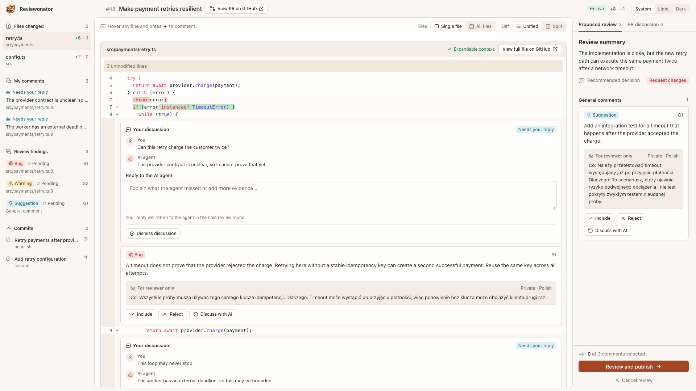

<div align="center">
  
  <h1>Reviewonator</h1>
  <p><strong>AI review, human decision.</strong></p>

  [](https://github.com/johniak/reviewonator/actions/workflows/ci.yml)
  [](https://github.com/johniak/reviewonator/releases)
  [](LICENSE)
</div>

Reviewonator turns an AI-generated pull request review into a focused, local review workspace. Inspect every finding in its diff context, revise the proposed wording, choose what to include, and publish only after an explicit confirmation.

Reviewonator supports Claude Code and Codex through one shared review workflow.

<p align="center">
  
</p>

See the [feature guide](docs/features.md) for a visual walkthrough of the review workspace, comment decisions, pull request discussion, and safe publishing flow.

## Why Reviewonator?

- Review findings appear next to the exact changed lines, with clearly visible severity levels.
- Read existing conversation comments, submitted reviews, and inline review comments without leaving the diff workspace.
- Browse one file at a time or scroll through all changed files.
- Switch between unified and side-by-side diffs.
- Expand context beyond the patch without exposing a GitHub token to the browser.
- Keep private reviewer explanations separate from comments sent to the pull request.
- Discuss any proposed finding with the AI agent live and send a reply directly from its card.
- Edit, include, or exclude each inline and general comment. Nothing is included by default.
- Preview the complete GitHub review before choosing **Comment**, **Approve**, or **Request changes**.
- Cancel safely: Reviewonator never publishes automatically.

## How it works

1. The installed Claude Code or Codex skill performs a pull request review and writes a validated JSON document.
2. The `reviewonator` executable retrieves pull request data through your authenticated GitHub CLI session.
3. A local loopback-only web application opens in your browser.
4. You inspect and edit the proposed review.
5. Reviewonator publishes only the selected content after an explicit confirmation.

Your GitHub credentials remain in the CLI process. They are never embedded in the page or written to the review JSON.

## Requirements

- macOS or Linux on x64 or ARM64
- [GitHub CLI](https://cli.github.com/) installed and authenticated with `gh auth login`
- [Claude Code](https://docs.anthropic.com/en/docs/claude-code/overview), Codex, or both
- Access to the pull request you want to review

[Bun](https://bun.sh/) is required only when building from source.

## Install

### Homebrew

```sh
brew install johniak/tap/reviewonator
reviewonator setup
```

Homebrew installs the executable and the GitHub CLI. `reviewonator setup` then installs the agent skill.

### Install script

Without Homebrew, run the install script with `curl` or `wget`. No clone is needed:

```sh
sh -c "$(curl -fsSL https://github.com/johniak/reviewonator/releases/latest/download/install.sh)"
```

```sh
sh -c "$(wget -qO- https://github.com/johniak/reviewonator/releases/latest/download/install.sh)"
```

The script downloads the latest release for your platform, verifies its SHA-256 checksum, installs the executable in `~/.local/bin/reviewonator`, and runs `reviewonator setup`. Make sure `~/.local/bin` is on your `PATH`, or pass `--bin-dir DIR`.

### Setup

`reviewonator setup` first requires an explicit multi-select choice for Claude Code, Codex, or both. It never chooses an agent integration silently. It then asks which language the agent should use for comments published to GitHub and for private reviewer notes. Both language choices default to English. It installs:

- the Claude Code skill in `~/.claude/skills/reviewonator`, when selected;
- the Codex skill in `~/.agents/skills/reviewonator`, when selected.

Your choices are saved in `~/.config/reviewonator/config.json`. Updates never ask for your targets or languages again. Run `reviewonator setup --reconfigure` to change them.

Non-interactive installation must provide `--targets` or `REVIEWONATOR_TARGETS`; setup never guesses. `--targets` accepts `claude`, `codex`, or a comma-separated selection. `REVIEWONATOR_COMMENT_LANGUAGE` and `REVIEWONATOR_REVIEWER_LANGUAGE` provide the remaining non-interactive configuration. Custom skill locations are supported with `--claude-skill-dir` and `--codex-skill-dir`. The install script passes these options to setup:

```sh
sh -c "$(curl -fsSL https://github.com/johniak/reviewonator/releases/latest/download/install.sh)" "" --targets claude,codex \
  --comment-language English \
  --reviewer-language English
```

To install from a source checkout instead:

```sh
bun install --frozen-lockfile
bun run build
./scripts/install.sh --local
```

Reviewonator uses ownership markers and refuses to overwrite or remove files it does not manage.

### Codex and GitHub authentication

On macOS, Codex's sandbox may be unable to read the GitHub CLI token stored in Keychain even though `gh auth status` succeeds in your normal terminal. The Reviewonator skill handles this by requesting permission to run authenticated `gh` commands and the Reviewonator process outside the sandbox. Approve only the narrowly scoped commands shown by Codex. This permission lets the process use your existing `gh` login; it does not publish a review. Publication still requires separate, explicit confirmation in the Reviewonator UI.

Do not work around the sandbox by copying the GitHub token into a prompt, configuration file, `GH_TOKEN`, or `GITHUB_TOKEN`.

## Use

Invoke the installed skill with a pull request URL.

In Claude Code:

```text
/reviewonator https://github.com/owner/repository/pull/123
```

In Codex:

```text
$reviewonator https://github.com/owner/repository/pull/123
```

The agent completes the review first, then launches one live Reviewonator workspace. In the application:

1. Read the private reviewer explanation for each finding.
2. Edit the public comment if needed.
3. Select only the findings you want to publish.
4. Add an optional general comment.
5. Open the publish preview and choose the GitHub review event.
6. Confirm the exact payload.

You can start a private live discussion either on an AI finding or on any diff line. The open workspace sends your message to the agent, shows its answer in place, and stays open for follow-up rounds. These discussions are never published directly to GitHub.

The review summary is optional for every event, including **Approve** and **Request changes**.

## Update and uninstall

Update to the latest release with:

```sh
reviewonator update
```

For a Homebrew installation this runs `brew upgrade reviewonator`; otherwise Reviewonator downloads the latest release, verifies its checksum, and replaces itself. Either way, the installed skills are refreshed with your saved languages. An update waits until an open live review has finished; `--force` overrides this and, for an install-script installation, also reinstalls or downgrades to the latest release. Running the install script again works too.

When a newer release exists, the review page shows a small notice with the update command. Set `REVIEWONATOR_NO_UPDATE_CHECK=1` to turn the check off.

Check the installed version with:

```sh
reviewonator --version
```

Remove one or both agent integrations with:

```sh
reviewonator uninstall
reviewonator uninstall --targets codex
```

The executable remains installed while another managed integration still uses it. A Homebrew installation is then removed with `brew uninstall reviewonator`.

## Development

```sh
bun install --frozen-lockfile
bun run dev -- https://github.com/owner/repository/pull/123 --review-file path/to/review.json
```

For a live development session, add `--live`. Agent-side development commands can then wait for work and return an updated review without reopening the browser:

```sh
bun run dev -- https://github.com/owner/repository/pull/123 --review-file path/to/review.json --live
reviewonator wait https://github.com/owner/repository/pull/123
reviewonator respond https://github.com/owner/repository/pull/123 --review-file path/to/updated-review.json
```

Useful commands:

```sh
bun run typecheck   # TypeScript validation
bun run test        # Production web build and full test suite
bun run build       # Single-file web app and native executable
bun run check       # Typecheck, tests, and production build
```

Tests exercise domain validation, GitHub integration boundaries, the HTTP server, browser behavior, the CLI, installation, and release packaging. Please do not replace real behavior with mocks unless an integration cannot be exercised practically.

## Release process

1. Update the version in `package.json`.
2. Ensure `bun run check` passes.
3. Create and push a tag such as `v0.1.0`.

The release workflow builds binaries for macOS and Linux on x64 and ARM64, packages the skill and license notices, creates SHA-256 checksums, and publishes a GitHub Release with `install.sh`. It then updates the formula in [johniak/homebrew-tap](https://github.com/johniak/homebrew-tap), which requires the `HOMEBREW_TAP_TOKEN` repository secret: a fine-grained token with contents write access to the tap.

## Project status

Reviewonator is an early-stage project. Its review workflow and JSON contract may evolve before version 1.0. Claude Code and Codex are supported today.

## Contributing and security

Contributions are welcome. Read [CONTRIBUTING.md](CONTRIBUTING.md) and the [Code of Conduct](CODE_OF_CONDUCT.md) before opening a pull request.

Please report vulnerabilities privately according to [SECURITY.md](SECURITY.md), not through a public issue.

## License

Reviewonator is available under the [MIT License](LICENSE). Third-party attribution is documented in [THIRD_PARTY_NOTICES.md](THIRD_PARTY_NOTICES.md).
