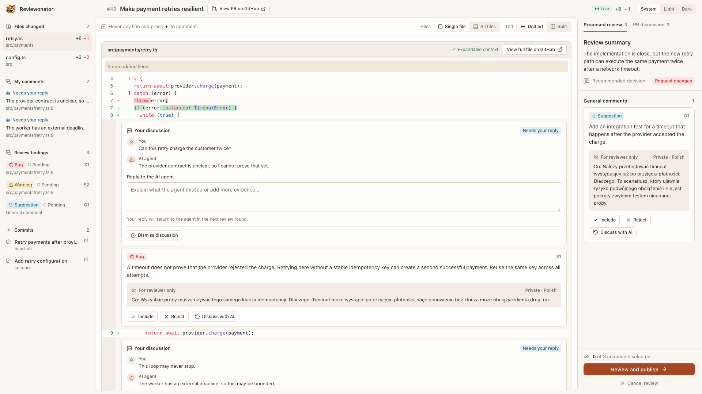
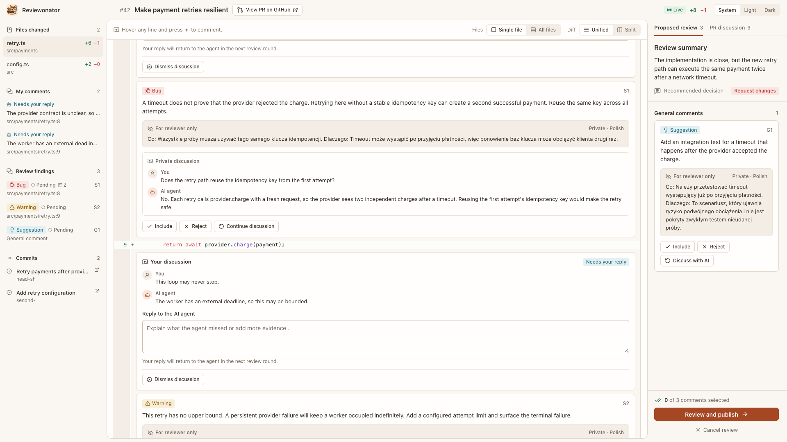
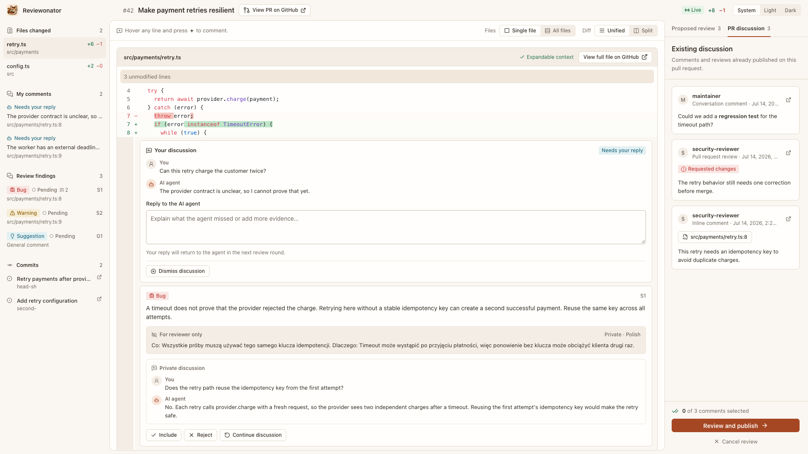
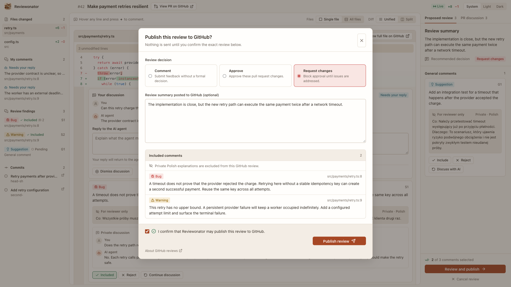

# Feature guide

Reviewonator is a local, human-in-the-loop workspace for pull request reviews created by an AI agent. The agent investigates the change and proposes findings; you decide what, if anything, reaches GitHub.

## Know what the pull request is for

The diff opens under **About this PR**: a private note of at most 100 words, written in plain language in your reviewer-note language. The agent builds it from the ticket and the code that actually changed, not from the author's description. It finds the ticket through issues linked to the pull request, ticket keys such as `ABC-123` in the title, branch, description, or commits, and any issue tracker it can read (GitHub Issues, or Jira and Linear through a connected tool). With a ticket, the note says what the ticket asks for, what the pull request really does, and where the two differ. Without one, it only explains what the pull request changes. Collapse the note to one line once you have read it; Reviewonator remembers that for the pull request. The note is never published to GitHub.

## Review the change in context

The workspace keeps the pull request, changed files, findings, and commits in one place. Each inline finding opens the relevant file and line. Severity borders and labels make bugs, warnings, suggestions, security issues, and nits easy to distinguish.

You can:

- review one file at a time or scroll through every changed file;
- switch between unified and side-by-side diffs;
- expand ten lines of context above or below a patch;
- open the complete file or pull request on GitHub;
- navigate directly between findings from the left sidebar;
- start your own private discussion with the AI agent on any diff line;
- tick **Viewed** on files you have understood, so you can move on and come back to the rest.

**Viewed** is the same per-user flag as on GitHub. Files you already marked there arrive ticked and collapsed, and ticking or unticking a file in Reviewonator updates GitHub immediately. When the author pushes a new change to a viewed file, GitHub clears the flag and the file comes back unviewed. The **Files changed** heading counts how many files you have viewed, and a viewed file can still be expanded with the arrow next to its name.

Context expansion is handled by the local Reviewonator process through your authenticated GitHub CLI session. GitHub credentials are never sent to the browser.

The workspace follows your system colour scheme and offers **System**, **Light**, and **Dark** switches in the header. Switching never resets the open file, scroll position, or drafts. Reviewonator remembers the colour theme, the single-file or all-files view, and the unified or side-by-side diff for the next review.

## Discuss your own concerns with the AI agent

Click **+** beside a diff line to start your own comment. **Send to AI** turns it into a private conversation with the agent. Use **Send to AI** on your comment to send just that comment; any other unsent messages stay where they are until you send them with the button in the review panel. Reviewonator keeps these conversations in a separate **My comments** section and never publishes them directly to GitHub. To put a comment straight into the review instead, use **Add comment** (see below).

The agent checks the exact code before responding. It can:

- agree, create a normal review finding, and link it to your discussion;
- disagree, explain why, and leave the discussion open for your next reply.

Only you can dismiss a discussion, and Reviewonator requires your reason. Drafts, replies, waiting discussions, linked findings, and dismissed discussions have distinct states in the sidebar, so it is clear who needs to act next.

The workspace stays open while you talk to the agent. After you send a comment, its status changes to **Waiting for agent** and the header shows **AI working**. The agent's reply appears in the same diff and browser session as soon as it is ready. You can continue the conversation for as many rounds as needed before publishing or cancelling the review.

## Write and edit comments yourself

Choose **Add comment** on your line comment to put it straight into the review, on any line of the diff, without an agent round. It is marked **You**, has no severity until you pick one, and starts pending like every finding, with the same **Include**, **Reject**, and **Discuss with AI** actions.

Edit any comment with the pencil on its card. Reviewonator keeps your wording across agent rounds unless you discuss that comment with the agent. An AI finding you changed is marked **Edited**. You can delete comments you wrote; AI findings are rejected instead.

## Decide what happens to every finding

Nothing is included by default. Every proposed comment has an explicit state:

- **Pending** — no decision has been made;
- **Included** — it will appear in the publication preview;
- **Revision requested** — your note is returned to the AI agent for another pass;
- **Rejected** — you consciously chose not to publish it.

These decisions persist when the AI agent returns a revised review, so accepted work is not lost. Public GitHub wording stays separate from the private reviewer note. The private note explains the issue in the configured reviewer language and is never published.

Each proposed finding also supports a private live discussion. Ask the agent about its evidence, challenge its conclusion, or request clearer wording. Your message and the agent's response remain visible below the finding, while the agent can update the proposed GitHub comment when the discussion changes the result. The browser stays open for every follow-up round, and the private conversation is never included in the published review.

Use **Send to AI** on the finding card to send only that reply. The bottom action remains available when you deliberately want to send several prepared discussions together.

## Read the existing pull request discussion

The **PR discussion** tab brings the conversation already on GitHub into the workspace. It includes conversation comments, submitted reviews, and inline review comments, with direct links back to their GitHub locations.

## Preview and publish deliberately

The final dialog shows the exact review that Reviewonator is prepared to send. You can choose the GitHub event — **Comment**, **Approve**, or **Request changes** — and inspect the selected comments in a scrollable list. The review summary is optional, including for approvals.

Publication requires a separate confirmation checkbox. Closing the dialog or cancelling the review publishes nothing.

## Use the same workflow with Claude Code or Codex

`reviewonator setup` can target Claude Code, Codex, or both. It also configures the language used for public comments and the separate language used for private reviewer notes; both default to English. `reviewonator update` keeps these choices and refreshes the installed skills. The review schema and human confirmation flow remain the same across supported agents.
